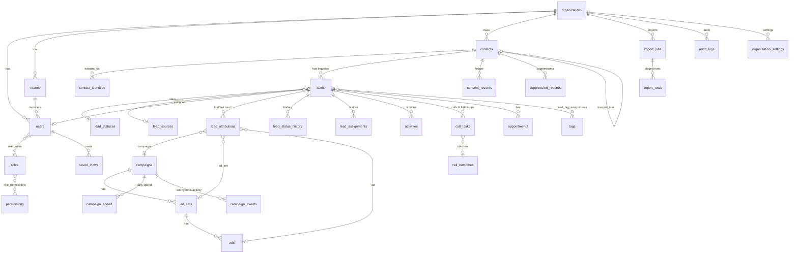

# LeadFlow CRM — Technical Architecture

## 1. Shape of the system

A Laravel 13 modular monolith on PHP 8.3+/8.4 and MySQL 8.4. Blade renders page shells; each page is driven by a jQuery module that talks to a versioned JSON API (`/api/v1`) using the same session cookie, so CSRF protection, session rotation and server-side authorization apply to every call. There is no SPA build step: Bootstrap 5.3, Bootstrap Icons, jQuery 4, Chart.js 4 and SortableJS are vendored under `public/vendor`, and the Content Security Policy is `'self'`-only (no inline script or style).

```
Browser (Blade shell + jQuery page module)
   │  session cookie + X-CSRF-TOKEN
   ▼
routes/api.php  /api/v1/*   ── middleware: web → auth → org.resolve → (permission:*)
   │
Controllers (thin)  →  FormRequests (validation)  →  Services (domain logic, transactions)
   │                                                     │
   ├── Policies / LeadVisibility (record-level scope)    ├── ActivityLogger, AuditLogger
   └── Resources (JSON shaping, PII discipline)          └── PhoneNormalizer, DuplicateDetector
   ▼
Eloquent models with BelongsToOrganization global scope  →  MySQL 8.4
   ▲
Queue workers / scheduler (imports, KB ingestion, webhooks, AI replies, rescoring, missed follow-ups)
   ▲
Provider adapters: WhatsApp CloudApiClient, MetaAdsClient (Marketing API + Lead Ads), ChatClient (OpenAI / DeepSeek) — each reports
an honest connection state; nothing is marked "connected" without a successful authenticated call.
AI layer: KnowledgeBase (hybrid BM25 + embeddings) → AiResponder (grounded JSON envelope) → ConversationAutomation
(auto-replies, suggest/auto modes, human handoff) → LeadQualifier + LeadScoring. See docs/AI_WHATSAPP.md.
Automation: domain services call AutomationEngine::fire(trigger, lead, eventId) after commit → RunAutomation job → ConditionEvaluator → actions;
timed triggers (uncontacted / overdue / inactive) and Reminders run from `automation:scan` every 5 minutes. See docs/AUTOMATION.md.
Audiences: SegmentQuery (definition → SQL) → AudienceService (eligibility, membership snapshot) → CSV export / MetaAudienceSync (hashed replace upload). See docs/AUDIENCES.md.
```

### Decisions taken up front

1. **Useful without APIs.** Manual entry, CSV/XLSX import, call logging, follow-ups, pipeline, dashboards and manual spend entry work on day one. Integrations are additive adapters.
2. **Ad activity ≠ people.** `campaign_events` stores anonymous/aggregate activity (CTWA clicks, conversation starts) with no contact FK. A `contact` only exists when a human-supplied identifier arrives (form, inbound message, import, manual entry).
3. **Multi-tenant from row one.** Every tenant table carries `organization_id`; `OrganizationScope` filters every query and `BelongsToOrganization` stamps inserts from the authenticated user's org. The client never supplies an organization id.
4. **Facts over labels.** Metrics derive from lifecycle timestamps on the lead (`first_contacted_at`, `first_responded_at`, `qualified_at`, `converted_at`, `closed_at`) plus semantic flags on statuses, so renaming or reordering pipeline stages never breaks reporting.
5. **Contacts vs leads.** One `contact` (a person/business with normalized identifiers) has many `leads` (inquiries/opportunities). Exact normalized phone/email/provider-id matches link a new inquiry to the existing contact; anything weaker is only ever a suggestion. Merges are explicit, permissioned, audited.

## 2. Tenancy & authorization

* `ResolveOrganization` middleware binds `CurrentOrganization` from `auth()->user()->organization_id`.
* RBAC: `roles` (per organization, seeded from templates) ↔ `permissions` (global keys) via `role_permissions`; users ↔ roles via `user_roles`. `Gate::before` maps permission keys; routes use `can:` middleware; services re-check.
* Record visibility (`LeadVisibility`): `leads.view_all` → whole org; `leads.view_team` → leads assigned to members of teams the user manages (plus own); `leads.view_own` → assigned to self. Applied to lists, detail, pipeline, follow-ups, dashboard and exports — the same scope everywhere, so a rep's dashboard is their own book.

| Role | Key permissions |
|---|---|
| Super Administrator | all |
| Business Administrator | all within the organization |
| Sales Manager | team leads, assign, bulk update, follow-ups (all visible), merge, reports, imports |
| Sales Representative | own leads, create/update, log calls, own follow-ups, consent capture |
| Marketing Manager | all leads read, campaigns + spend, reports, exports, imports, audiences |
| Read-Only Analyst | dashboard, reports, campaigns (aggregates only, no lead PII) |

## 3. Data model (relationship plan)

```
organizations 1─* users *─* roles *─* permissions
organizations 1─* teams 1─* users (team_id); teams.manager_user_id → users
organizations 1─* contacts 1─* contact_identities (provider, external_id)   ← dedupe keys
contacts 1─* leads *─1 lead_statuses / lead_sources / users(assigned)
leads 1─* lead_attributions (first/last touch; external ids + name snapshots) *─0..1 campaigns/ad_sets/ads
campaigns 1─* ad_sets 1─* ads ;  campaigns 1─* campaign_spend (daily, currency, source)
campaigns 1─* campaign_events (anonymous/aggregate, no contact FK)
leads 1─* lead_status_history, lead_assignments, activities (timeline), call_tasks, appointments
leads *─* tags (lead_tag_assignments)
contacts 1─* consent_records (append-only), suppression_records
organizations 1─* call_outcomes (configurable, drive counters/status advancement)
organizations 1─* import_jobs 1─* import_rows (staged, per-row action + messages)
users 1─* saved_views ; organizations 1─* organization_settings ; audit_logs (append-only)
integrations (encrypted credentials, per-business webhook key) · webhook_events (unique body hash)
contacts 1─* conversations 1─* messages (unique wamid) ; message_templates (synced from Meta)
ai_assistants (1 per business) · auto_reply_rules · kb_documents 1─* kb_chunks (search_text + packed vector)
ai_interactions (every AI call: tokens, latency, outcome, feedback) · notifications (deduped per user)
leads: + score, score_label, score_factors (JSON), ai_summary, language
automation_rules 1─* automation_executions (unique (rule, dedupe_key) = exactly-once per event) · users.notification_prefs
lead_forms 1─* lead_form_submissions (unique (org, external_lead_id); outcome per leadgen id) ; campaigns.ad_account_id, ad_sets/ads.status
audience_segments 1─* audience_segment_memberships (snapshot: eligible + reason, removed_at) ; audience_segments 1─* audience_sync_jobs (csv_export | meta_replace)
```

Deviations from the suggested table list, with reasons:
* `campaign_external_ids` → explicit `campaigns`, `ad_sets`, `ads` tables, each with `(organization_id, platform, external_id)` unique keys. Attribution rows keep both the FK and the external id + display-name snapshot, so renames never rewrite history.
* `import_errors` → `import_rows` holds every staged row with its planned action (`create|update|new_lead|skip|review|error`) and messages; the error report is `action = error`. This also powers the dry-run preview and resumable batches.
* `application_settings` → `organization_settings` (key/JSON value per organization).
* `lead_tags` + `lead_tag_assignments` → `tags` + `lead_tag_assignments` (one pivot).

Conventions: UTC timestamps; display in organization/user time zone. Money is `DECIMAL(14,2)` + `CHAR(3)` currency. Phone numbers keep `*_raw` alongside `*_e164`. Soft deletes only on contacts/leads (archival); suppression and legal deletion are separate procedures.

## 4. Navigation map

| # | Item | Phase | Permission |
|---|---|---|---|
| 1 | Dashboard | 2 | dashboard.view |
| 2 | Leads (list, filters, saved views, bulk, detail) | 2 | leads.view_* |
| 3 | Contacts (dedupe, merge, consent) | 2 | contacts.view |
| 4 | Sales Pipeline (Kanban) | 2 | leads.view_* |
| 5 | WhatsApp Inbox | ✓ | whatsapp.view / whatsapp.send |
| 5a | AI Assistant (config, prompt, test chat, auto-replies, learning) | ✓ | ai.manage |
| 5b | Knowledge Base | ✓ | kb.manage |
| — | Platform Admin (businesses, system health) | ✓ | users.is_platform_admin |
| — | My profile (details, language, time zone, password) | ✓ | any |
| 6 | Calls & Follow-ups | 2 | followups.manage_own/all |
| 7 | Calendar & Appointments | 2 | followups.manage_own/all |
| 8 | Campaigns (+ manual spend) | 2 (API sync 4) | campaigns.view |
| 9 | Audience Segments (builder, eligibility, preview, CSV) | ✓ | audiences.manage |
| 10 | Retargeting (Meta Custom Audiences, sync history) | ✓ | audiences.manage |
| 11 | Analytics & Reports | ✓ | reports.view |
| 12 | Team & Assignments | 2 | users.manage |
| 13 | Import / Export | 2 | imports.run / leads.export |
| 14 | Integrations (WhatsApp, OpenAI, DeepSeek, Meta Marketing + Lead Ads) | ✓ | integrations.manage |
| 15 | Automation Rules (builder, tester, execution history) | ✓ | automation.manage |
| 16 | Audit Logs | 2 | audit.view |
| 17 | Settings (org, statuses, sources, outcomes, roles) | 2 | settings.manage |

Modules from later phases appear in navigation with an explicit "planned for Phase N" state — never with sample data.

## 5. Phased checklist

- [x] **Phase 1 — Foundation:** project skeleton, migrations, Argon2id auth with throttling + session rotation, RBAC, org isolation, security headers/CSP, layout + reusable UI components.
- [x] **Phase 2 — Core CRM** (37 automated tests passing; browser-verified): dashboard (real data, honest ad-metric states), contacts + leads, search/filters/saved views/column chooser, bulk actions, lead detail + timeline, Kanban + status rules, calls/follow-ups/appointments, CSV/XLSX import wizard with dry run + error report, safe exports, campaigns + manual spend, team/users, settings, audit log.
- [x] **AI & WhatsApp release:** WhatsApp Cloud API (signed, idempotent webhooks; inbox; templates; 24h window; delivery statuses), OpenAI + DeepSeek assistant with knowledge base, instant auto-replies, suggest/auto modes with handoff, human-approved learning, lead qualification, transparent scoring, round-robin assignment, in-app notifications, analytics & reports, platform admin (multi-business), Urdu/Arabic UI with RTL, profile and business settings. 62 automated tests.
- [x] **Phase 3 — Automation:** rule engine (trigger → conditions → actions; exactly-once per event, loop guard, dry-run tester, execution history), five starter rules per business (first-contact assignment off by default; SLA, escalation, qualified alert, 3-unanswered-calls on), built-in callback/appointment reminders, email notifications with per-user preferences (sent only when a real mailer is configured), round-robin, scoring, missed follow-ups.
- [x] **Phase 4 — Integrations:** WhatsApp Cloud API, OpenAI, DeepSeek, Meta Marketing API (campaign structure, daily spend with API-over-manual precedence, aggregate events) and Lead Ads (signed `leadgen` webhook + hourly backfill; exactly-once per leadgen id; no fabricated contacts). 76 automated tests.
- [x] **Phase 5 — Marketing intelligence:** analytics & reports with CSV export; dynamic audience segments with two-level AND/OR, always-on opt-out exclusion, consent policies, exclusion lists, membership snapshots on the lead timeline, audited CSV / hashed exports, Meta Custom Audience creation and full-replace hashed uploads with live Meta size/delivery status. 82 automated tests. See docs/AUDIENCES.md.
- [x] **Phase 6 — Production readiness:** security review (docs/SECURITY.md), index review + additions, built-in error monitoring (fingerprinted, admin notifications, optional webhook), scheduler/worker heartbeats, `leadflow:doctor` readiness checks (CLI + Platform Admin), `leadflow:backup` archives with off-server guidance and restore drill, per-business retention policies, audited contact erasure, personal API tokens for external clients, deployment guide (docs/DEPLOYMENT.md). 87 automated tests.

## 6. ER diagram (Phases 1–2)



Key indexes: `(organization_id, phone_e164)`, `(organization_id, whatsapp_e164)`, `(organization_id, email_normalized)` on contacts; `(organization_id, lead_status_id | assigned_user_id | created_at | next_follow_up_at | lead_source_id | contact_id)` on leads; `(organization_id, status, scheduled_at)` on call_tasks; unique `(organization_id, external_lead_id)` on leads and `(organization_id, provider, external_id)` on contact_identities for idempotent ingestion.
